# Project visual gallery — source-grounded cards

[GitHub profile](../README.md) · [Technical evidence index](PROJECT_REVIEW_INDEX.md) · [Original image inventory and upload guide](REPOSITORY_FINISHING_GUIDE.md)

These **13 version-controlled, 1280 × 640 portfolio presentation cards** contain screenshots or research figures already published in the corresponding project repositories. Each card links to its project; the original source image is linked separately below. These are **editorial covers**, not fresh screenshots of a running service, acceptance tests, clinical outcomes, verified industrial deployments, or evidence that a repository's GitHub **Social Preview setting** has been updated.

The source projects determine the evaluation metrics, attribution, dataset licensing, demo limits and current release state. In particular, some cards deliberately embed **research figures rather than application UI**; a Workintech collaborative fork must not be represented as solely authored work. No live-demo or recent-production capture is implied by the card generation date.

## Data science, analytics and applied ML

| | |
| :---: | :---: |
| **[IEEE Fraud Risk Intelligence](https://github.com/senanurcetin/ieee-fraud-detection-analytics)**  [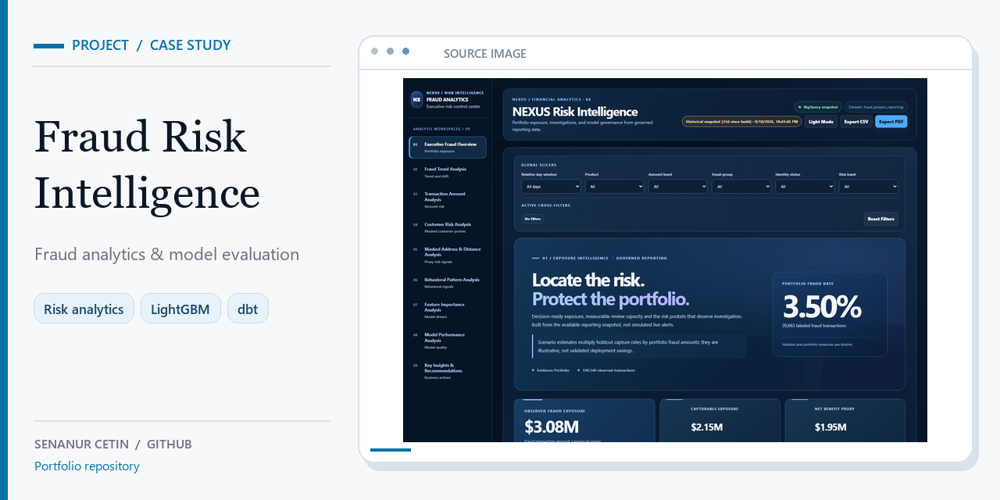](https://github.com/senanurcetin/ieee-fraud-detection-analytics)  Application dashboard screenshot; historical evaluation, not live transaction monitoring. [Original source image](https://github.com/senanurcetin/ieee-fraud-detection-analytics/blob/main/docs/assets/web_dashboard_executive_overview.png). | **[MS Capital Forecasting](https://github.com/senanurcetin/ms-capital-market-forecasting)**  [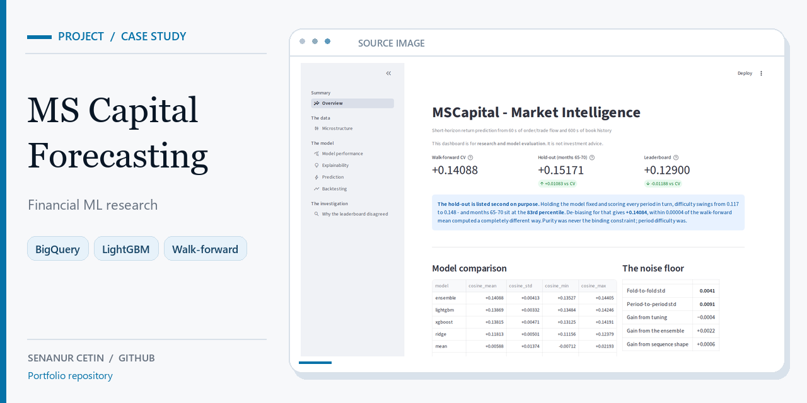](https://github.com/senanurcetin/ms-capital-market-forecasting)  Research dashboard; the served v3 model is not the submitted v4 ensemble. [Original source image](https://github.com/senanurcetin/ms-capital-market-forecasting/blob/main/docs/assets/mscapital-research-dashboard.png). |
| **[Smart Factory Analytics](https://github.com/senanurcetin/smart-factory-app)**  [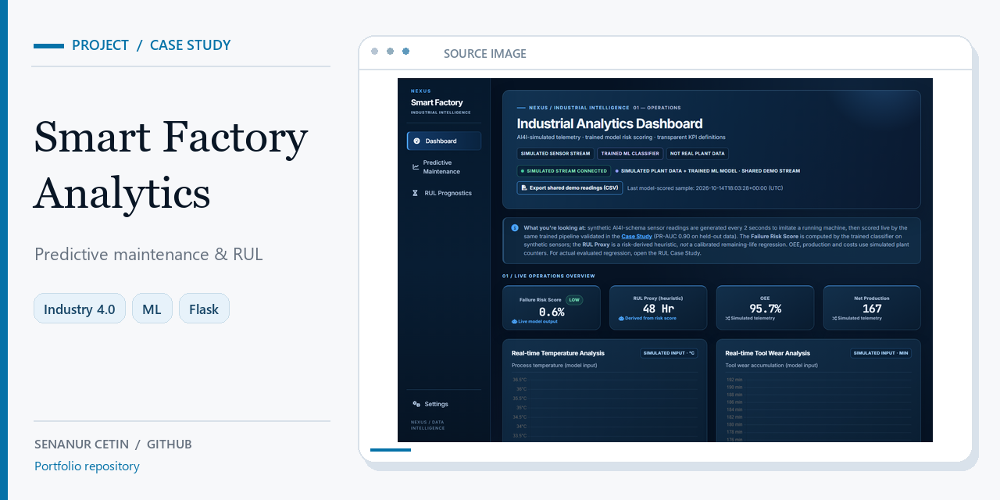](https://github.com/senanurcetin/smart-factory-app)  Simulated maintenance interface; offline AI4I and RUL studies are separate. [Original source image](https://github.com/senanurcetin/smart-factory-app/blob/main/docs/assets/smart-factory-dashboard.png). | **[Visual QC](https://github.com/senanurcetin/visual-qc-project)**  [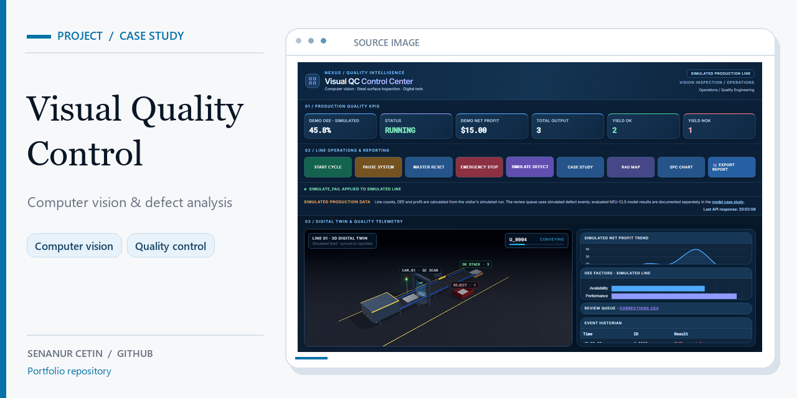](https://github.com/senanurcetin/visual-qc-project)  Simulated operator interface; NEU-CLS model evaluation is separate. [Original source image](https://github.com/senanurcetin/visual-qc-project/blob/main/docs/assets/visual-qc-dashboard.png). |
| **[APTOS Retinopathy Research](https://github.com/senanurcetin/APTOS-2019-diabetic-retinopathy)**  [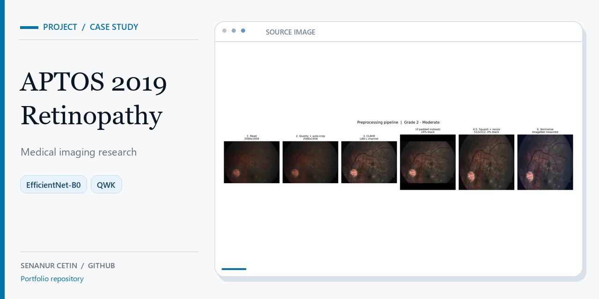](https://github.com/senanurcetin/APTOS-2019-diabetic-retinopathy)  Preprocessing **research figure**, not a clinical UI or medical device. [Original source image](https://github.com/senanurcetin/APTOS-2019-diabetic-retinopathy/blob/main/reports/figures/05_pipeline_stages.png). | **[CASMI26 Molecular Identification](https://github.com/senanurcetin/enveda-casmi26)**  [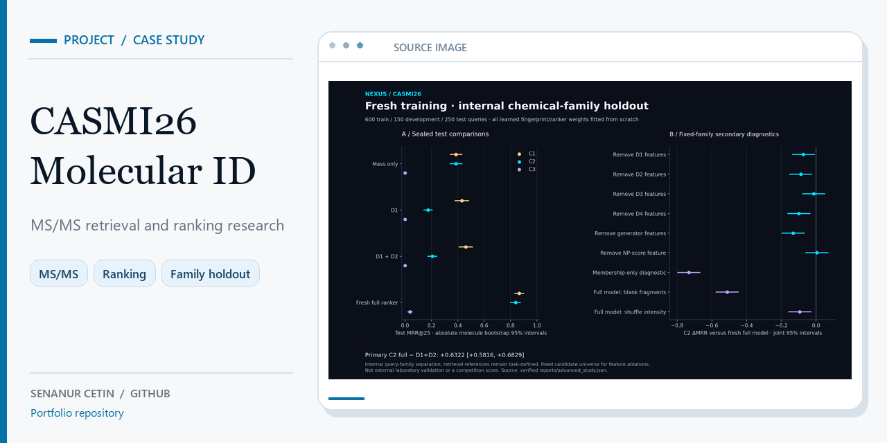](https://github.com/senanurcetin/enveda-casmi26)  Internal ranking-study **figure**, not independent lab validation. [Original source image](https://github.com/senanurcetin/enveda-casmi26/blob/main/docs/assets/advanced-internal-study.png). |
| **[Football Intelligence](https://github.com/senanurcetin/football-player-performance-analysis)**  [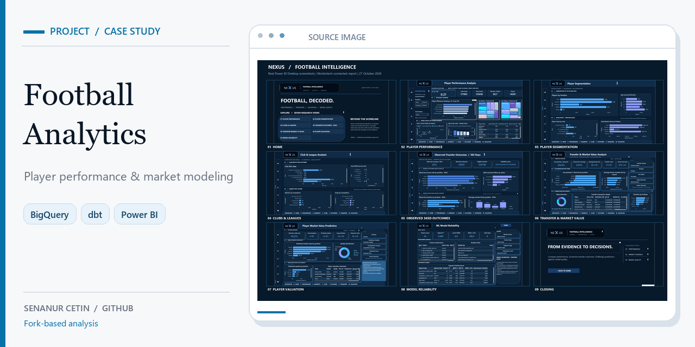](https://github.com/senanurcetin/football-player-performance-analysis)  Historical Power BI screenshot gallery from a Workintech team-project fork. [Original source image](https://github.com/senanurcetin/football-player-performance-analysis/blob/main/docs/assets/screenshots/NEXUS_Football_Page_Gallery.png). | **[NEXUS Commerce Intelligence](https://github.com/senanurcetin/nexus-commerce-intelligence)**  [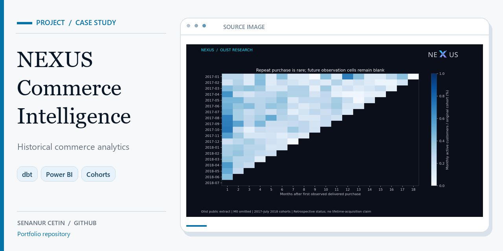](https://github.com/senanurcetin/nexus-commerce-intelligence)  Historical Olist cohort-analysis **figure**, not a live dashboard. [Original source image](https://github.com/senanurcetin/nexus-commerce-intelligence/blob/main/docs/advanced-analysis/cohort_retention.png). |

## Industrial research and operator-facing software

| | |
| :---: | :---: |
| **[OT-Sentinel](https://github.com/senanurcetin/ot-sentinel)**  [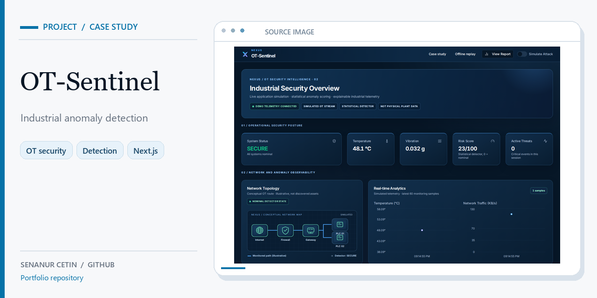](https://github.com/senanurcetin/ot-sentinel)  Synthetic OT telemetry; no live PLC/DCS connection or safety protection. [Original source image](https://github.com/senanurcetin/ot-sentinel/blob/main/docs/assets/nexus-dashboard-normal.png). | **[Ops-Copilot](https://github.com/senanurcetin/Ops-Copilot)**  [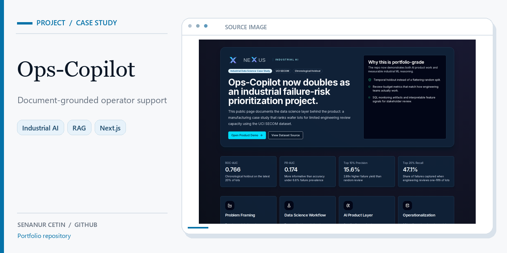](https://github.com/senanurcetin/Ops-Copilot)  SECOM case-study screenshot; industrial research and read-only tooling. [Original source image](https://github.com/senanurcetin/Ops-Copilot/blob/main/docs/assets/nexus-secom-case-study-desktop.png). |
| **[Vision2DCS](https://github.com/senanurcetin/Vision2DCS)**  [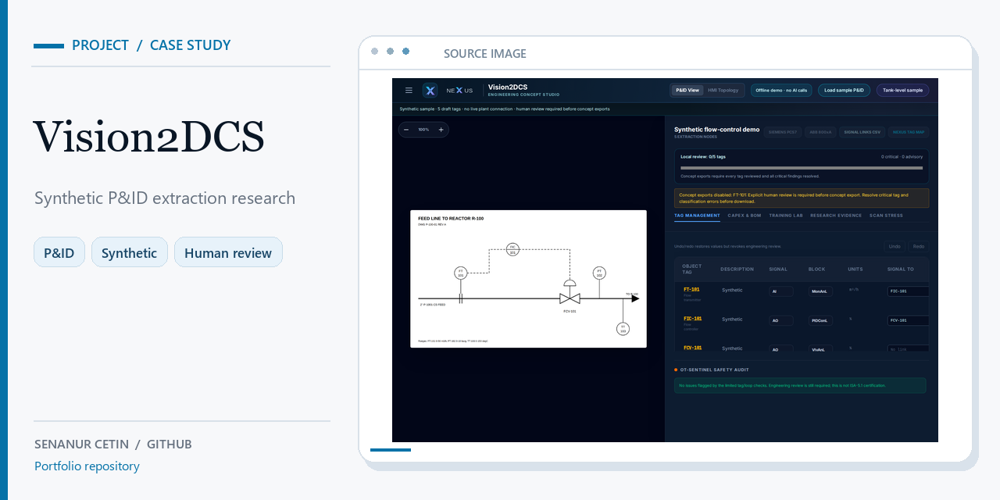](https://github.com/senanurcetin/Vision2DCS)  Synthetic P&ID/tag research interface; no certified DCS export. [Original source image](https://github.com/senanurcetin/Vision2DCS/blob/main/docs/assets/nexus-workspace-desktop.png). | **[PlantLog](https://github.com/senanurcetin/PlantLog-MERN)**  [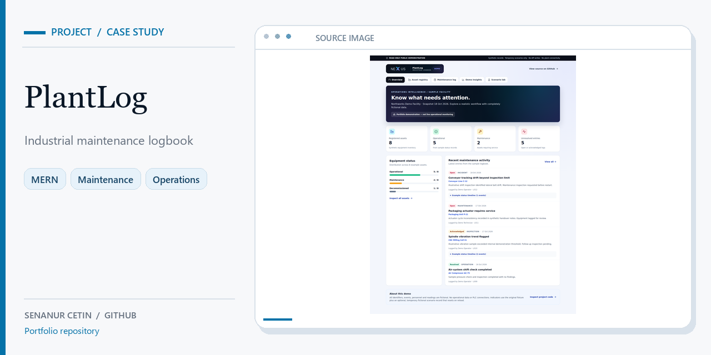](https://github.com/senanurcetin/PlantLog-MERN)  Synthetic guest-demo screenshot; not a production maintenance backend. [Original source image](https://github.com/senanurcetin/PlantLog-MERN/blob/main/docs/screenshots/nexus-demo-overview.png). |
| **[ChemView](https://github.com/senanurcetin/ChemView)**  [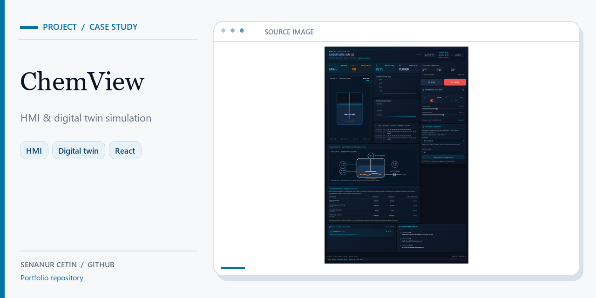](https://github.com/senanurcetin/ChemView)  Fictional mixing-vessel HMI simulation, not a connected controller. [Original source image](https://github.com/senanurcetin/ChemView/blob/main/docs/assets/chemview-dashboard.png). |   |

---

**Publication status:** all 13 cards and the [contact-sheet overview](../assets/social-previews/contact-sheet.jpg) are committed to this GitHub profile repository. Uploading any of them as the corresponding repository's actual Social Preview is a separate authenticated **Settings → General → Social preview** operation and remains **unverified**. The publication [finishing guide](REPOSITORY_FINISHING_GUIDE.md) tracks matching upload pages, source evidence and manual review boundaries.

**Provenance rule:** do not use a generated card as experimental data, replace a source screenshot with synthesized UI, imply paid hosting or machine/process control, or mistake a historical research figure for a current application capture.
